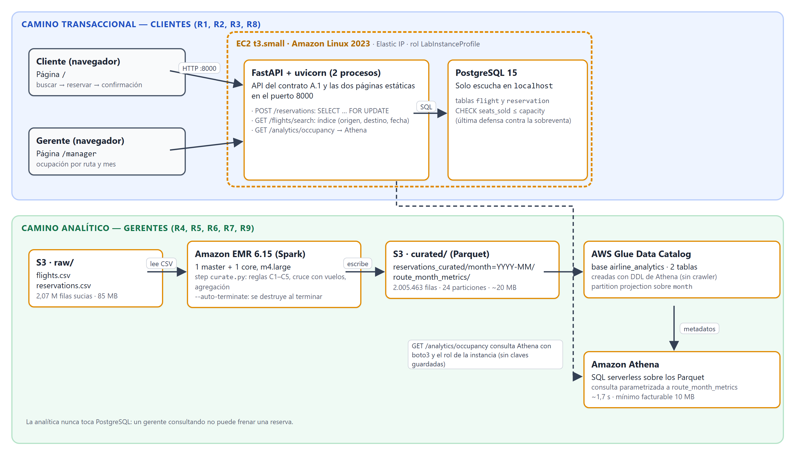

# Parcial 2 — Sistema de reservas de aerolínea con panel analítico

Big Data e Ingeniería de Datos · seed del equipo **190** · AWS Academy Learner Lab (us-east-1)

Continuación del parcial 1: el sistema funciona de punta a punta y lo mide el harness del docente.
Resultado: **70/70** ([report.md](report.md)). Documento de entrega: [docs/PARCIAL2-DOCUMENTO.docx](docs/PARCIAL2-DOCUMENTO.docx).



## Dos caminos que no se tocan

- **Transaccional (clientes):** una EC2 `t3.small` corre FastAPI (API + páginas `/` y `/manager`) y PostgreSQL 15 local.
  La reserva usa `SELECT … FOR UPDATE` sobre la fila del vuelo, más un `CHECK` en la base: cero sobreventa (R2).
- **Analítico (gerentes):** CSV crudo en S3 → EMR (PySpark, reglas C1–C5) → Parquet particionado por mes →
  Glue Data Catalog → Athena → `GET /analytics/occupancy` → panel.

## Estructura

| Ruta | Contenido |
|---|---|
| `emr/curate.py` | Job PySpark: limpieza C1–C5, cruce con vuelos, `reservations_curated` y `route_month_metrics` |
| `backend/app/` | `main.py` (API + páginas), `booking.py` (R1–R3), `analytics.py` (Athena, R7), `static/` (frontend) |
| `backend/sql/schema.sql` | Tablas `flight` y `reservation`, CHECK anti-sobreventa, índice de búsqueda |
| `athena/ddl.sql` | Base y tablas del Glue Data Catalog (partition projection por mes) |
| `infra/` | Scripts de despliegue numerados y `validate_sample.py` (compara la salida de EMR con el oráculo) |
| `config.yaml` | Configuración del harness (sin credenciales) |
| `cost_projection.yaml` | Proyección mensual de costos (US$ 19,83) |
| `docs/` | Documento Word, diagramas, evidencia y los scripts que los generan |

## Despliegue (Git Bash, credenciales del Learner Lab en `~/.aws/credentials`)

```bash
python -m airline_data.generate --seed 190 --rows 2000000 --out data/raw   # desde la carpeta del harness
bash infra/01_s3.sh                    # bucket + datos crudos + job
bash infra/02_emr.sh sample            # prueba barata con la muestra
python infra/validate_sample.py s3://airline-p2-<cuenta>/curated-sample 100000
bash infra/02_emr.sh full              # dataset completo (el cluster se apaga solo)
bash infra/03_athena.sh                # tablas en el Glue Data Catalog
bash infra/04_ec2.sh                   # EC2 con API, frontend y PostgreSQL
bash infra/05_redeploy.sh              # redesplegar el backend tras un cambio
```

Antes de correr el harness, verificar que no quede ningún cluster EMR vivo (R10/R11).

## Pruebas adicionales (`pruebas/`)

Simulan la corrida del docente, que usa una copia propia del harness con un `probe_salt` secreto. Resultado del 22-oct-2026:

| Prueba | Resultado |
|---|---|
| Harness limpio (descomprimido del ZIP original) con `probe_salt: 31337` | 70/70 |
| `con_salts.sh`: R7 y R9 con 5 salts distintos | 5/5 (30 pares ruta-mes distintos) |
| `todos_los_pares.py`: el endpoint con los 336 pares ruta-mes | 336/336, máx. 3,2 s |
| `test_contrato.py`: casos 404/409/422, 100 reservas por 1 silla, 80 por 20 con analítica en paralelo, búsqueda con 50 clientes, selectores | 28/28 |

```bash
python pruebas/todos_los_pares.py <carpeta-harness> http://100.60.245.136:8000
BASE_URL=http://100.60.245.136:8000 python -m pytest pruebas/test_contrato.py -q
bash pruebas/con_salts.sh <copia-limpia-del-harness> python
```
Las credenciales nunca se suben al repositorio.
